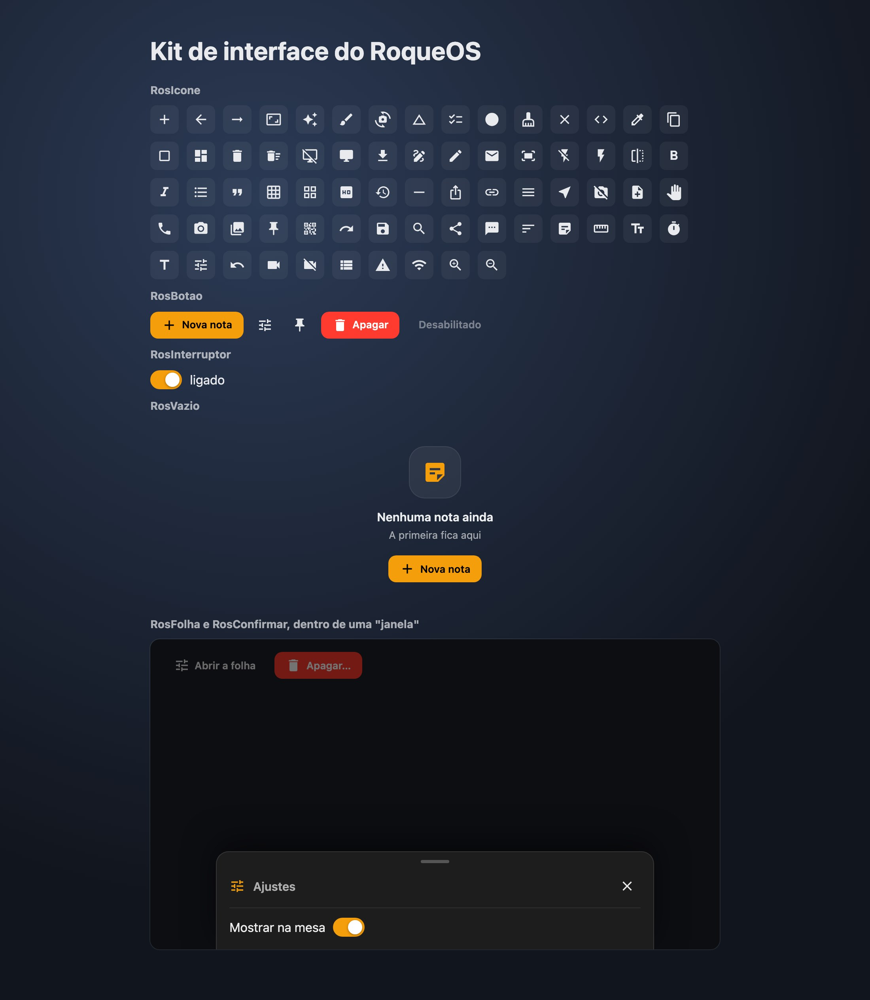
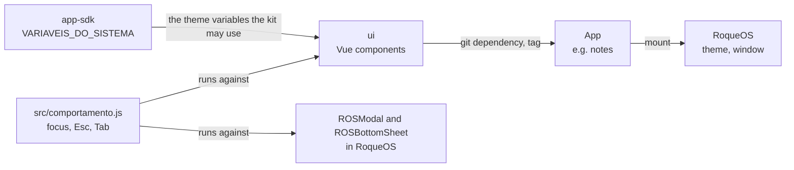

# ui

_[Português](README.pt-BR.md) | English_

The interface kit for [RoqueOS](https://roqueos.com.br) apps: icon by name, button, switch,
settings sheet, confirmation and empty state, so an app that lives outside RoqueOS looks and
behaves like one inside it. Vue only: no Quasar and nothing from RoqueOS.



## Why it exists

RoqueOS apps are leaving the system repository, which is closed, for repositories of their own
in the [roqueos-apps](https://github.com/roqueos-apps) organization, talking to it through the
[`app-sdk`](https://github.com/roqueos-apps/app-sdk). Inside RoqueOS they drew the screen with
the system components (`ROSModal`, `ROSBottomSheet`, `q-icon`), which depend on Quasar and on
the stores; outside, those components do not exist. This kit is what they use instead.

It was born with Notes (Wave 4a of Goal 28, 27/09/2026) and grows with the next app that needs
more: a component with no app using it cannot be tested against real use.

## Architecture



- The app installs the kit as a git dependency pinned by tag, and the RoqueOS Vite build
  compiles the source, as it compiles the app.
- Colours come from the RoqueOS theme through the variables the `app-sdk` contract lists
  (`--ros-fill-rgb`, `--ros-text-rgb`...), always with a fallback value, so the app looks the
  same in `yarn dev`, outside RoqueOS. The app colour comes in as a prop (`acento`).
- The text of each component comes in through props, already in the app's language. The kit
  has no language.

The whole picture, with the flows and the design decisions, is in
[docs/ARCHITECTURE.md](docs/ARCHITECTURE.md).

## The components

| Component        | What for                                                              | What it guarantees                                                                                                                   |
| ---------------- | --------------------------------------------------------------------- | ------------------------------------------------------------------------------------------------------------------------------------ |
| `RosIcone`       | a Material Icons icon by name (`nome`)                                | the strokes of the font RoqueOS uses; a name outside `ICONES` is a Vue warning; decorative                                           |
| `RosBotao`       | `primario`, `fantasma` or `perigo`                                    | an icon-only button carries `rotulo` as `aria-label`; toggling (`ligado`) says `aria-pressed`                                        |
| `RosInterruptor` | on and off (`v-model`)                                                | `role="switch"` with `aria-checked`; Space, Enter and the TV OK button toggle; moves the other way in RTL                            |
| `RosFolha`       | settings and choices, rising from the bottom                          | modal dialog with a title; focus enters, stays and returns; Esc, the scrim, close and the handle dragged down close it               |
| `RosConfirmar`   | the question before what cannot be undone                             | `alertdialog`; opens with focus on Cancel; Esc and the scrim cancel; `perigo` paints it red                                          |
| `RosVazio`       | the empty state ("Nenhuma nota ainda"), and loading with `carregando` | `role="status"`, icon in the app colour, action in the slot; `carregando` adds the running bar (still with `leve` or reduced motion) |

`prenderFoco(el)` and `focaveis(el)` also ship in the package, for the app that needs to trap
focus in a panel of its own. Every prop, event and slot is in
[docs/REFERENCE.md](docs/REFERENCE.md).

### What the kit does not do, on purpose

The sheet and the confirmation live **inside the app root** (which needs `position: relative`)
and cover the app window, not the screen. The kit never touches the `document`: no style on
`body`, no listener on `document` or `window`, no Teleport. RoqueOS locks `body` scrolling with
a counter of its own when it opens one of its modals; a kit that also touched it would unlock
the system scroll under an open modal. Esc in an open sheet does not bubble either: with the
sheet open, Esc belongs to it, not to the window.

### The same behaviour on both sides

RoqueOS keeps its own components, and the two families must behave alike.
[`src/comportamento.js`](src/comportamento.js) is the executable behaviour contract of an
overlay: it is a modal dialog to the screen reader, focus enters on open, Esc closes, focus
returns to whoever opened it, and Tab does not leave it. The kit passes all of it; RoqueOS runs
the same pack against `ROSModal` and `ROSBottomSheet`, and what one side does not meet yet is
written down, with the reason, in the `pular` list of its test.

```js
import { describe, test, expect } from 'vitest'
import { testarSobreposicao } from '@roqueos-apps/ui/comportamento'

testarSobreposicao({ describe, test, expect }, { nome: 'RosFolha', montar })
```

What no automated test covers is the device: focus with the TV D-pad and the sheet with the
iPhone keyboard open go into each app's device QA.

## How to use it in an app

```json
{ "dependencies": { "@roqueos-apps/ui": "github:roqueos-apps/ui#v0.6.0" } }
```

Always by tag, never by branch. `github:` downloads over HTTPS and asks for no key.

```vue
<template>
  <div class="my-app">
    <RosVazio v-if="vazio" icone="sticky_note_2" :titulo="t('vazio')" acento="#f59e0b" />
    <RosFolha v-model="ajustes" :titulo="t('ajustes')" :rotulo-fechar="t('fechar')">
      <RosInterruptor v-model="naMesa" :rotulo="t('naMesa')" acento="#f59e0b" />
    </RosFolha>
  </div>
</template>

<script setup>
import { RosFolha, RosInterruptor, RosVazio } from '@roqueos-apps/ui'
</script>

<style>
.my-app {
  position: relative; /* the sheet and the confirmation attach here */
}
</style>
```

The package surface (the two exports, the tag, the single copy RoqueOS forces) is in
[docs/INTEGRATIONS.md](docs/INTEGRATIONS.md).

## Getting started

Node 22 or newer (`.nvmrc` says 24) and Yarn 1 (`packageManager` in `package.json`).

```bash
yarn install --ignore-scripts
yarn verificar   # lint, format, tests and app check --sdk, the same as CI and pre-push
yarn dev         # the showcase, each component in the states that matter (?dir=rtl for Arabic)
node scripts/icones.mjs <path to @quasar/extras> icon_name   # new icon
```

Step by step, with how to know each command worked, in
[docs/GETTING-STARTED.md](docs/GETTING-STARTED.md).

## Structure

```text
src/
  index.js          what the package exports
  RosIcone.vue      RosBotao.vue  RosInterruptor.vue  RosFolha.vue  RosConfirmar.vue  RosVazio.vue
  icones.js         the icons (generated by scripts/icones.mjs)
  foco.js           prenderFoco and focaveis, without touching the document
  sobreposicao.js   the focus of the sheet and the confirmation
  comportamento.js  the executable behaviour contract of an overlay
scripts/icones.mjs  generates src/icones.js from @quasar/extras
dev/                the yarn dev showcase
test/               Vitest with jsdom: components, behaviour, document, rules
```

## Where it fits in the family

The `app-sdk` defines the contract between RoqueOS and an app, including the theme variables the
kit uses. The kit depends on that and on nothing else; the apps depend on both. When the kit
needs a new theme variable, it goes into the `app-sdk` first (and RoqueOS starts failing if it
disappears from the theme), then into the kit, then into the app. The order is in the
`roqueos-kit` graph (`roqueos-graph blast`).

## Status and limits

Version 0.6.0 ([CHANGELOG.md](CHANGELOG.md)), used by Notes, QR Code, Whiteboard (Lousa) and
Camera, and by RoqueOS itself, which runs the behaviour pack against its own overlays. Six
components and 70 icons. The gate runs in jsdom; what only a real device shows (TV D-pad,
iPhone keyboard) is manual QA in each app. The known limits are in
[docs/ARCHITECTURE.md](docs/ARCHITECTURE.md#9-known-limits).

## Documentation

Start at [docs/INDEX.md](docs/INDEX.md), the map from what you want to the document that
answers it. In it: [getting started](docs/GETTING-STARTED.md),
[architecture](docs/ARCHITECTURE.md), [reference](docs/REFERENCE.md),
[operations](docs/OPERATIONS.md), [when it breaks](docs/WHEN-IT-BREAKS.md),
[glossary](docs/GLOSSARY.md), [extending](docs/EXTENDING.md),
[integrations](docs/INTEGRATIONS.md) and [testing](docs/TESTING.md). Every document has its
Portuguese pair in [docs/pt-BR/](docs/pt-BR/INDEX.md).

## Contributing

Read [CONTRIBUTING.md](CONTRIBUTING.md). Every commit carries `Signed-off-by` (DCO), and CI
checks it. A security flaw goes through [SECURITY.md](SECURITY.md), never through a public
issue. Code, comments and commits are in Brazilian Portuguese; English issues and pull requests
are welcome.

## License

[MIT](LICENSE). The icons are Material Icons (Apache-2.0); their origin is in
[ASSETS.md](ASSETS.md). The RoqueOS name and brand belong to LEVELHARD and are not part of the
license.
