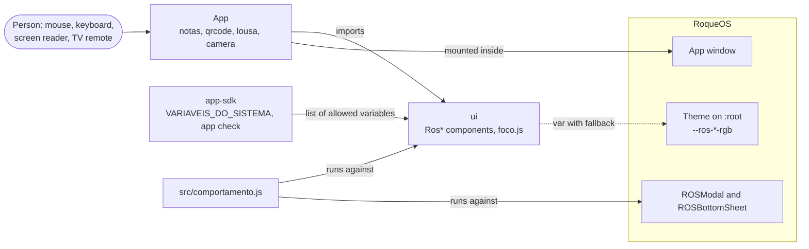
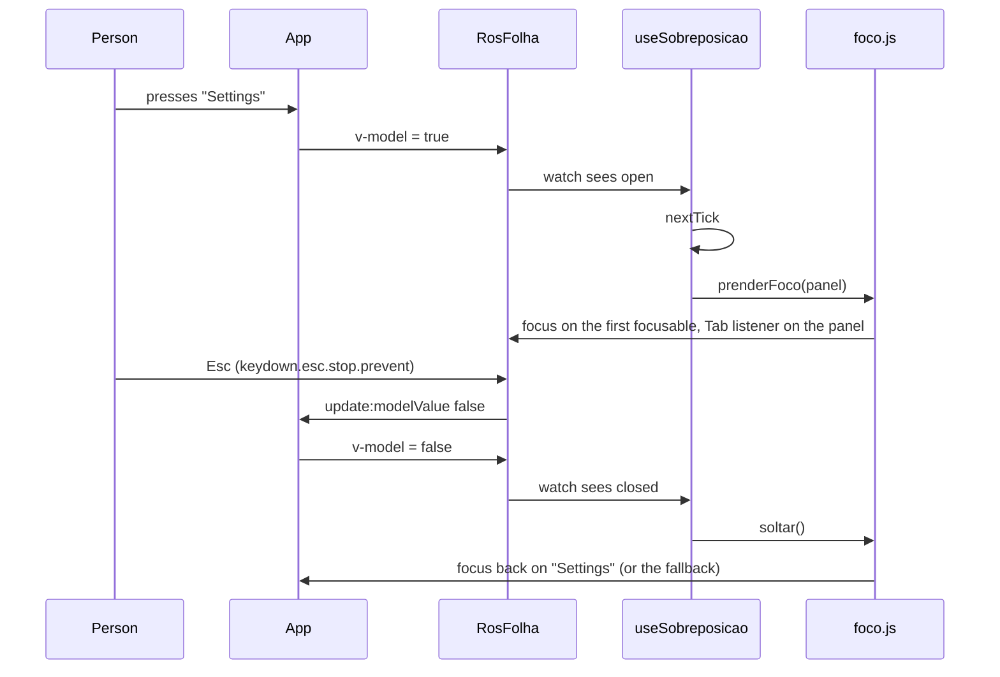
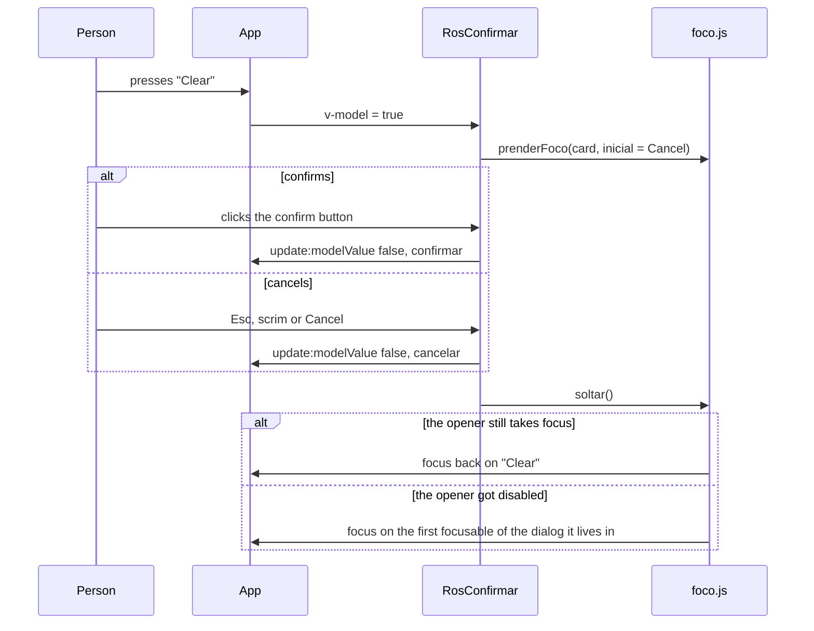
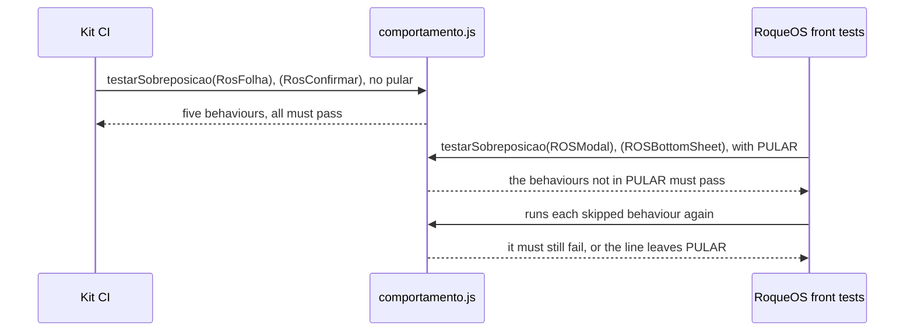

# Architecture

_[Português](pt-BR/ARQUITETURA.md) | English_

> **For whom:** whoever changes a component, reviews a pull request, or changes RoqueOS overlays
> and needs to know what the kit promises.
> **What is here:** the idea, the context, where the code runs, each part with its file, the
> main flows, the contracts, the design decisions and the known limits.
> **Where to go for the rest:** every prop and script is in [REFERENCE.md](REFERENCE.md); how
> an app and RoqueOS consume the package is in [INTEGRATIONS.md](INTEGRATIONS.md).

## Contents

1. [The idea](#1-the-idea)
2. [Context](#2-context)
3. [Where it runs](#3-where-it-runs)
4. [Components](#4-components)
5. [Main flows](#5-main-flows)
6. [Data and contracts](#6-data-and-contracts)
7. [Secrets](#7-secrets)
8. [Design decisions](#8-design-decisions)
9. [Known limits](#9-known-limits)
10. [How the diagrams are made](#10-how-the-diagrams-are-made)

## 1. The idea

An app that left RoqueOS lost the system components (`ROSModal`, `ROSBottomSheet`, `q-icon`),
which need Quasar and the RoqueOS stores. The kit gives it the same pieces in plain Vue: six
components, the focus helpers and 70 icons. It looks like RoqueOS because it reads the RoqueOS
theme through the CSS variables the `app-sdk` contract allows, with a fallback for when it runs
alone. It behaves like RoqueOS because the overlay behaviour is an executable pack
([src/comportamento.js](../src/comportamento.js)) that runs against the kit here and against
the RoqueOS components there. It owns nothing outside the app root: not the `document`, not the
language, not the data.

## 2. Context



Who uses it: the apps of the roqueos-apps organization that left RoqueOS. Today Notes, QR Code,
Whiteboard (Lousa) and Camera pin `github:roqueos-apps/ui#v0.6.0` in their `package.json`, and
the RoqueOS front has the kit as a devDependency and in `resolutions`, at the same tag, to run
the behaviour pack against its own overlays.

What it depends on: `vue` (peer dependency `^3.5.0`), and, only during development, the
`app-sdk` (the variable list and the `app check`). At runtime it reads the RoqueOS theme
variables; it does not import anything from RoqueOS.

What happens when a dependency is missing: without the RoqueOS theme (the `yarn dev` showcase,
a test) every `var(--ros-...)` falls back to the value written next to it, which is the dark
look (white text, surface `30, 30, 30`). Without a positioned app root, the sheet and the
confirmation attach to the nearest positioned ancestor, which may be the page.

## 3. Where it runs

The kit has no process of its own and no build. It is source code that another build compiles.

| Where                         | Who compiles                        | What runs                                                                |
| ----------------------------- | ----------------------------------- | ------------------------------------------------------------------------ |
| Inside RoqueOS, in an app     | the RoqueOS Vite, from the source   | the components, in the app's Vue, inside the app window                  |
| An app's `yarn dev` and tests | the app's Vite and Vitest           | the same components, with the fallback colours                           |
| This repository's `yarn dev`  | [vite.config.js](../vite.config.js) | the showcase ([dev/](../dev/Vitrine.vue)); this file does not ship       |
| This repository's gate and CI | Vitest with jsdom                   | the tests in [test/](../test/componentes.spec.js) and the behaviour pack |
| The RoqueOS front tests       | the front's Vitest                  | `@roqueos-apps/ui/comportamento` against `ROSModal` and `ROSBottomSheet` |

`package.json` declares `"private": true` and `"exports"` straight to `src/`: nothing is
published to npm and there is no `dist/` to ship.

## 4. Components

| Part               | File                                                | What it does                                                                                       |
| ------------------ | --------------------------------------------------- | -------------------------------------------------------------------------------------------------- |
| Package entry      | [src/index.js](../src/index.js)                     | exports the six components, `ICONES`, `prenderFoco` and `focaveis`                                 |
| Icon               | [src/RosIcone.vue](../src/RosIcone.vue)             | draws an SVG from `ICONES[nome]`; `aria-hidden`; a validator rejects an unknown name               |
| Button             | [src/RosBotao.vue](../src/RosBotao.vue)             | three variants; icon-only gets `aria-label`; `ligado` gives `aria-pressed`                         |
| Switch             | [src/RosInterruptor.vue](../src/RosInterruptor.vue) | `<button role="switch">`, emits the opposite value; knob mirrors in RTL                            |
| Sheet              | [src/RosFolha.vue](../src/RosFolha.vue)             | modal dialog inside the app root; Esc, scrim, close and dragging the handle more than 110 px close |
| Confirmation       | [src/RosConfirmar.vue](../src/RosConfirmar.vue)     | `alertdialog`; focus starts on Cancel; emits `confirmar` or `cancelar`                             |
| Empty state        | [src/RosVazio.vue](../src/RosVazio.vue)             | `role="status"`; `carregando` adds the running bar, still with `leve` or reduced motion            |
| Focus trap         | [src/foco.js](../src/foco.js)                       | `prenderFoco` and `focaveis`: focus in, Tab wraps, focus back, fallback when the opener is gone    |
| Overlay composable | [src/sobreposicao.js](../src/sobreposicao.js)       | `useSobreposicao`: traps focus when the overlay opens, releases when it closes or unmounts         |
| Behaviour pack     | [src/comportamento.js](../src/comportamento.js)     | `testarSobreposicao` and `COMPORTAMENTOS`: the five behaviours as tests, with `pular`              |
| Icons              | [src/icones.js](../src/icones.js)                   | 70 names to SVG paths, generated, not edited                                                       |
| Icon generator     | [scripts/icones.mjs](../scripts/icones.mjs)         | reads `@quasar/extras` and rewrites `src/icones.js`                                                |
| Showcase           | [dev/Vitrine.vue](../dev/Vitrine.vue)               | every component in the states that matter, for `yarn dev`                                          |

## 5. Main flows

### 5.1 Opening and closing a sheet



The Esc listener sits on the sheet root with `.stop`, so it never reaches the RoqueOS window
([src/RosFolha.vue](../src/RosFolha.vue)). The Tab listener sits on the panel, not on the
`document` ([src/foco.js](../src/foco.js)). `soltar()` only gives focus back if focus is still
inside the overlay or on `body`: if the person clicked elsewhere in the app, focus stays there.

### 5.2 The confirmation



Focus starts on Cancel so that an Enter left over from typing, or the TV OK pressed twice, does
not delete anything ([src/RosConfirmar.vue](../src/RosConfirmar.vue)). The fallback branch
exists since 0.2.1: in QR Code, "Limpar" disables itself when the history empties, focus fell
to `body`, and Esc and Tab no longer reached the sheet that was still open (measured in the
`yarn dev` QA, Chromium, 28/09/2026; [CHANGELOG.md](../CHANGELOG.md)).

### 5.3 The behaviour pack on both sides



The pack is in [src/comportamento.js](../src/comportamento.js); the kit side is
[test/comportamento.spec.js](../test/comportamento.spec.js). The RoqueOS side lives in the
front, `tests/component/roqueos/sobreposicoes-comportamento.spec.js`, and its `PULAR` only
shrinks: a skipped behaviour that starts passing fails that block until the line is removed.

## 6. Data and contracts

The kit keeps no data. Its contracts are three.

**Props and events.** Every component takes its text by prop, already translated, and reports
changes by `update:modelValue` (and `confirmar`/`cancelar` in the confirmation). The table of
every prop is in [REFERENCE.md](REFERENCE.md#2-components). Example from the
[README](../README.md#how-to-use-it-in-an-app):

```vue
<RosConfirmar
  v-model="confirmar"
  titulo="Apagar a nota?"
  texto="Ela some das Notas e da área de trabalho."
  icone="delete"
  perigo
  rotulo-confirmar="Apagar"
  rotulo-cancelar="Cancelar"
  @confirmar="apagar"
/>
```

**Theme variables.** The kit reads only `--ros-*` variables from `VARIAVEIS_DO_SISTEMA` in the
`app-sdk` 0.2.0, always with a fallback (`rgba(var(--ros-fill-rgb, 255, 255, 255), 0.08)`), and
declares only `--rui-*` variables of its own. [test/regras.spec.js](../test/regras.spec.js)
runs the SDK's `conferirVariaveis` on `src/`.

**The behaviour pack.** `testarSobreposicao(t, { nome, montar, pular, esperar })` takes the
test functions and a `montar()` that returns `quemAbre`, `abrir()`, `aberta()`, `dialogo()` and
`desmontar()`. The five keys of `COMPORTAMENTOS` (`papel`, `focoEntra`, `escFecha`,
`focoVolta`, `tabDaVolta`) are the names `pular` uses. Details in
[INTEGRATIONS.md](INTEGRATIONS.md#3-the-behaviour-pack).

## 7. Secrets

None. The kit does not talk to a network, server or database, CI reads no secret
([.github/workflows/ci.yml](../.github/workflows/ci.yml),
[.github/workflows/dco.yml](../.github/workflows/dco.yml)), and installing it needs no key. What
protects people using RoqueOS is in [SECURITY.md](../SECURITY.md).

## 8. Design decisions

| Decision                                                                                  | Rejected alternative                              | Why                                                                                                                                                    | Since                  |
| ----------------------------------------------------------------------------------------- | ------------------------------------------------- | ------------------------------------------------------------------------------------------------------------------------------------------------------ | ---------------------- |
| Never touch the `document`: no `body` style, no `document`/`window` listener, no Teleport | a Teleport to `body`, like a common modal library | RoqueOS locks `body` scroll with its own counter; a kit touching it would unlock the system scroll under an open modal ([src/foco.js](../src/foco.js)) | 0.1.0, 27/09/2026      |
| Overlays live inside the app root and cover the app window                                | cover the whole screen                            | follows from the line above: with no Teleport, the overlay stays where the app mounted it                                                              | 0.1.0                  |
| Import only `vue` and its own files                                                       | reuse Quasar or RoqueOS components                | the app mounts its own Vue, and Quasar from RoqueOS does not reach inside it                                                                           | 0.1.0                  |
| Text by prop, no language in the kit                                                      | i18n inside the kit                               | the repository states the rule ([CLAUDE.md](../CLAUDE.md)) without a written reason: the app passes its own translated text                            | 0.1.0                  |
| Theme only through `VARIAVEIS_DO_SISTEMA`, with fallback                                  | copy the colour values                            | a copied value stops following the light and dark themes; a name outside the list fails the SDK check                                                  | 0.1.0, `app-sdk` 0.2.0 |
| The kit handles every Tab inside the overlay, not only at the edges                       | let the browser move in the middle                | Safari skips buttons on Tab by default, and focus left the sheet from the first button (measured in WebKit, 27/09/2026)                                | 0.1.0                  |
| The confirmation opens with focus on Cancel                                               | focus on the confirm button                       | a stray Enter or a double TV OK must not delete                                                                                                        | 0.1.0                  |
| Icons as generated SVG paths, committed                                                   | depend on `@quasar/extras` or on the icon font    | the kit imports only `vue`; the strokes are the same as the font RoqueOS uses ([ASSETS.md](../ASSETS.md))                                              | 0.1.0                  |
| Distributed as a git dependency pinned by tag, source only, `private: true`               | publish to npm, ship a build                      | the consumer's Vite compiles the source like the app's; the lockfile pins the commit ([SECURITY.md](../SECURITY.md))                                   | 0.1.0                  |
| A component enters with the first app that needs it, in the same cycle                    | a complete design system up front                 | a component with no consumer cannot be tested against real use ([CONTRIBUTING.md](../CONTRIBUTING.md))                                                 | 0.1.0                  |
| Overlay behaviour is an executable pack shared with RoqueOS                               | a written checklist                               | looking alike is checked by eye; behaving alike, only by running                                                                                       | 0.1.0                  |
| Dragging the sheet handle more than 110 px closes it                                      | no gesture                                        | the same limit as `ROSBottomSheet`; Notes, Camera and Whiteboard lost the gesture when they left the core (parity audit, 28/09/2026)                   | 0.6.0, 28/09/2026      |
| Focus falls back to the overlay the opener lives in                                       | always give focus to the opener                   | a disabled opener sent focus to `body`, out of reach of Esc and Tab (QR Code, 28/09/2026)                                                              | 0.2.1, 28/09/2026      |

## 9. Known limits

- **The gate runs in jsdom, not in a browser.** Layout, real pointer capture, Safari's Tab and
  the TV D-pad are not proven by the tests. What was measured in a browser has a date in the
  [CHANGELOG](../CHANGELOG.md) (WebKit 27/09/2026, Chromium 28/09/2026); everything else is
  manual QA in `yarn dev` and in each app.
- **Device behaviour is not covered by any automated test**: the TV D-pad and the sheet with
  the iPhone keyboard open are in each app's device QA.
- **The overlay covers the app window, not the screen,** and needs a positioned app root. With
  a `static` root it attaches to whatever positioned ancestor exists.
- **Esc inside an open sheet or confirmation never reaches the RoqueOS window.** This is the
  intent, and it means a window-level Esc in RoqueOS does nothing while an overlay of the kit is
  open.
- **Outside RoqueOS the look is always the dark one.** The fallback values are dark-theme
  values; the light theme only appears inside RoqueOS.
- **`focaveis` does not check visibility.** It filters by selector, `disabled` and `inert`; an
  element hidden by CSS still counts. No bug traced to this; not proven either way.
- **Only the 70 icons in `ICONES`.** Material Symbols names (such as `ink_eraser`) do not exist
  in Material Icons and cannot be added ([CHANGELOG.md](../CHANGELOG.md), 0.3.0).
- **RoqueOS forces a single copy.** The front's `resolutions` pins one tag for every app, so an
  app asking an older tag gets the front's one. The kit changes only in compatible ways within
  0.x, or every app moves together ([INTEGRATIONS.md](INTEGRATIONS.md#4-the-single-copy-in-roqueos)).

## 10. How the diagrams are made

Every diagram is Mermaid inside the Markdown, versioned with the text; GitHub renders it. The
Portuguese pair has the same diagrams with translated labels. The list is in
[INDEX.md](INDEX.md#diagrams).
