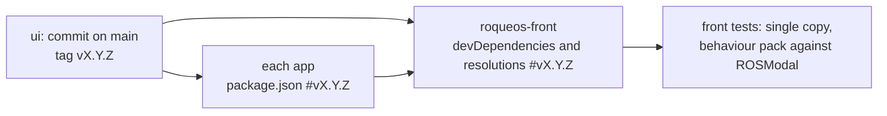

# Operations

_[Português](pt-BR/OPERACAO.md) | English_

> **For whom:** the maintainer, and whoever releases a version or moves the apps to it.
> **What is here:** the maintenance routine, releasing a tag, updating without breaking the
> apps, undoing, backup, and what to watch.
> **Where to go for the rest:** a failure with its message is in
> [WHEN-IT-BREAKS.md](WHEN-IT-BREAKS.md); who consumes the package and how is in
> [INTEGRATIONS.md](INTEGRATIONS.md).

## Contents

1. [The routine](#1-the-routine)
2. [Release a version](#2-release-a-version)
3. [Update without breaking](#3-update-without-breaking)
4. [Undo](#4-undo)
5. [Backup and restore](#5-backup-and-restore)
6. [What to watch](#6-what-to-watch)

## 1. The routine

There is no schedule and nothing runs on its own besides CI. The kit's maintenance routine is
[.claude/loop.md](../.claude/loop.md): one thing per iteration, stop at the first that has work.

| Order | Check                          | How                                                                                              |
| ----- | ------------------------------ | ------------------------------------------------------------------------------------------------ |
| 1     | Gate red                       | `roqueos-gate` (which runs `yarn verificar`); fix it and paste the output                        |
| 2     | GitHub CI red                  | `gh run list --limit 3`; red there and green here is a diverging environment, investigated first |
| 3     | Pull request without sign-off  | the `dco` check fails; the contributor gets `git rebase --signoff main`                          |
| 4     | Outside issue or PR unanswered | `gh issue list`, `gh pr list`                                                                    |
| 5     | Diverging behaviour            | a new line in the RoqueOS front `PULAR`, or a behaviour the kit lost, becomes an issue here      |
| 6     | SDK behind                     | a new theme variable goes into the `app-sdk` first, with a tag, then here                        |
| 7     | Docs drift                     | README, CHANGELOG and the component list say the same thing; `roqueos-docs` says `ok`            |

A visible change does not close without the showcase really open (`yarn dev`) with a
screenshot, and without the app that uses the component open in RoqueOS when the change gets
there.

## 2. Release a version

There is no release script or release workflow in the repository
([.github/workflows/](../.github/workflows/ci.yml) has only `verificar` and `dco`). A version
is a git tag `vX.Y.Z` on `main` that matches `version` in [package.json](../package.json) and a
section in [CHANGELOG.md](../CHANGELOG.md). The CHANGELOG states the rule: a new component or
prop is a minor version; changing what a component does with the same prop, or removing one,
is a major version.

```bash
yarn verificar
# package.json: "version": "0.7.0"; CHANGELOG.md: [Não lançado] becomes [0.7.0] - date
git commit -s -am "versao 0.7.0"
git tag v0.7.0
git push origin main v0.7.0
```

The version numbers above are an example. The kit is not published anywhere else:
`"private": true` keeps it off npm.



## 3. Update without breaking

The RoqueOS front forces one copy of the kit for every app through `resolutions`, and its test
`apps-de-primeira-parte` fails if `resolutions` and `devDependencies` differ or if an installed
app carries its own copy. An app that asks for an older tag gets the front's one. So:

1. Inside 0.x, change only in compatible ways (new prop, new component, new icon), or plan to
   move every app together.
2. When the kit needs a new theme variable, the order is `app-sdk` (variable and tag), then
   the kit (devDependency on the new SDK tag, `yarn verificar`, new kit tag), then the apps and
   the front. This order is in the `roqueos-kit` graph (`roqueos-graph blast`).
3. A change in focus, Esc or Tab changes what people feel in both families. A new behaviour in
   the pack can fail `ROSModal` in the front on the same bump; that is the point, and the front
   records it in its `PULAR` with the reason.
4. Bump the apps by editing the tag in their `package.json` and running their own gate; then
   the front's `devDependencies` and `resolutions`, on the same tag.

## 4. Undo

| Irreversible step             | How to undo                                                                                                                        |
| ----------------------------- | ---------------------------------------------------------------------------------------------------------------------------------- |
| A merged commit on `main`     | `git revert -s <commit>` in a new pull request; never force-push `main`                                                            |
| A pushed tag                  | do not move or delete it: consumers' lockfiles pin the commit ([SECURITY.md](../SECURITY.md)); release the next patch with the fix |
| An app bumped to a bad tag    | put the previous tag back in the app's `package.json` (and in the front's `resolutions`), `yarn install`                           |
| A regenerated `src/icones.js` | `git checkout -- src/icones.js`, or rerun `scripts/icones.mjs` with the right `@quasar/extras`                                     |

## 5. Backup and restore

The kit has no data and no state. The repository on GitHub is the backup; the tags are the
releases. Restoring is `git clone https://github.com/roqueos-apps/ui.git` and
[GETTING-STARTED.md](GETTING-STARTED.md). The icon paths are rebuilt from any `@quasar/extras`
1.18.0 checkout (the `roqueos-front` one serves, says [scripts/icones.mjs](../scripts/icones.mjs)).

## 6. What to watch

| Signal                               | Healthy                                                                                           |
| ------------------------------------ | ------------------------------------------------------------------------------------------------- |
| `yarn verificar`                     | ends with `ok, o repo cumpre o contrato.`; 5 test files and 38 tests passed (measured 18/11/2026) |
| GitHub Actions `verificar` on `main` | green on the last runs (`gh run list --limit 3`)                                                  |
| `dco` on every pull request          | green                                                                                             |
| The front `PULAR` list               | does not grow                                                                                     |
| `roqueos-docs`                       | `roqueos-docs: ok`                                                                                |
| `roqueos-doctor`                     | no `nao` line other than the ones already explained in the PR that introduced them                |
