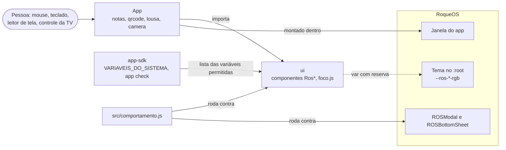
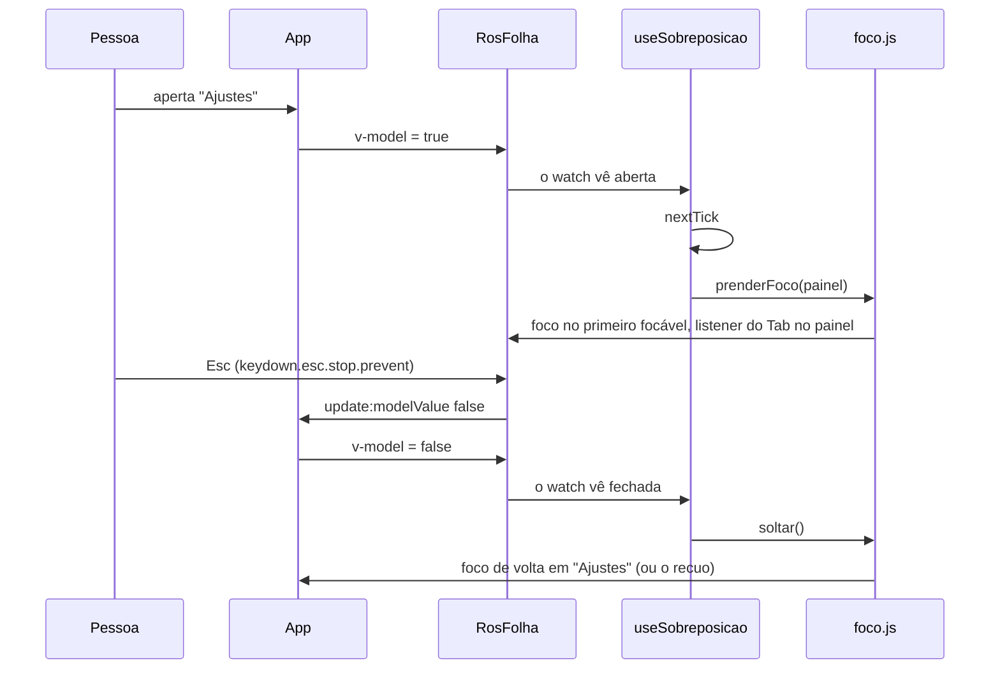
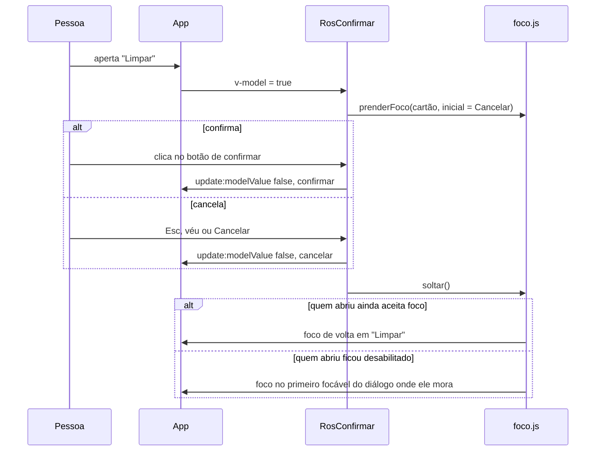
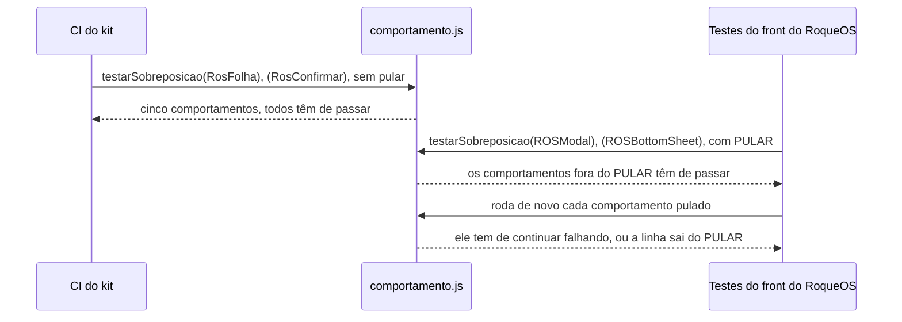

# Arquitetura

_Português | [English](../ARCHITECTURE.md)_

> **Para quem:** quem muda um componente, revisa um PR, ou mexe nas sobreposições do RoqueOS e
> precisa saber o que o kit promete.
> **O que tem aqui:** a ideia, o contexto, onde o código roda, cada parte com o arquivo dela, os
> fluxos principais, os contratos, as decisões de design e os limites conhecidos.
> **Onde ir para o resto:** cada prop e script está em [REFERENCIA.md](REFERENCIA.md); como um
> app e o RoqueOS consomem o pacote está em [INTEGRACOES.md](INTEGRACOES.md).

## Sumário

1. [A ideia](#1-a-ideia)
2. [Contexto](#2-contexto)
3. [Onde roda](#3-onde-roda)
4. [Componentes](#4-componentes)
5. [Fluxos principais](#5-fluxos-principais)
6. [Dados e contratos](#6-dados-e-contratos)
7. [Segredos](#7-segredos)
8. [Decisões de design](#8-decisões-de-design)
9. [Limites conhecidos](#9-limites-conhecidos)
10. [Como os diagramas são feitos](#10-como-os-diagramas-são-feitos)

## 1. A ideia

Um app que saiu do RoqueOS perdeu os componentes do sistema (`ROSModal`, `ROSBottomSheet`,
`q-icon`), que precisam do Quasar e das stores do RoqueOS. O kit dá a ele as mesmas peças em
Vue puro: seis componentes, as funções de foco e 70 ícones. Ele parece o RoqueOS porque lê o
tema do RoqueOS pelas variáveis CSS que o contrato do `app-sdk` permite, com valor de reserva
para quando roda sozinho. Ele se comporta como o RoqueOS porque o comportamento de sobreposição
é um pacote executável ([src/comportamento.js](../../src/comportamento.js)) que roda contra o
kit aqui e contra os componentes do RoqueOS lá. Ele não é dono de nada fora da raiz do app: nem
do `document`, nem do idioma, nem do dado.

## 2. Contexto



Quem usa: os apps da organização roqueos-apps que saíram do RoqueOS. Hoje as Notas, o QR Code,
a Lousa e a Câmera pinam `github:roqueos-apps/ui#v0.6.0` no `package.json`, e o front do
RoqueOS tem o kit como devDependency e no `resolutions`, na mesma tag, para rodar o pacote de
comportamento contra as sobreposições dele.

Do que depende: do `vue` (peer dependency `^3.5.0`) e, só no desenvolvimento, do `app-sdk` (a
lista de variáveis e o `app check`). Em execução ele lê as variáveis do tema do RoqueOS; não
importa nada do RoqueOS.

O que acontece quando falta uma dependência: sem o tema do RoqueOS (a vitrine do `yarn dev`,
um teste) cada `var(--ros-...)` cai no valor escrito ao lado, que é o visual escuro (texto
branco, superfície `30, 30, 30`). Sem uma raiz de app com posição, a folha e a confirmação se
prendem ao ancestral posicionado mais próximo, que pode ser a página.

## 3. Onde roda

O kit não tem processo próprio nem build. É código-fonte que outro build compila.

| Onde                          | Quem compila                           | O que roda                                                                       |
| ----------------------------- | -------------------------------------- | -------------------------------------------------------------------------------- |
| Dentro do RoqueOS, num app    | o Vite do RoqueOS, a partir do fonte   | os componentes, no Vue do app, dentro da janela do app                           |
| `yarn dev` e testes de um app | o Vite e o Vitest do app               | os mesmos componentes, com as cores de reserva                                   |
| `yarn dev` deste repo         | [vite.config.js](../../vite.config.js) | a vitrine ([dev/](../../dev/Vitrine.vue)); este arquivo não vai junto            |
| Gate e CI deste repo          | Vitest com jsdom                       | os testes de [test/](../../test/componentes.spec.js) e o pacote de comportamento |
| Testes do front do RoqueOS    | o Vitest do front                      | `@roqueos-apps/ui/comportamento` contra o `ROSModal` e o `ROSBottomSheet`        |

O `package.json` declara `"private": true` e `"exports"` direto para `src/`: nada vai para o
npm e não há `dist/` para entregar.

## 4. Componentes

| Parte                      | Arquivo                                                | O que faz                                                                                         |
| -------------------------- | ------------------------------------------------------ | ------------------------------------------------------------------------------------------------- |
| Entrada do pacote          | [src/index.js](../../src/index.js)                     | exporta os seis componentes, `ICONES`, `prenderFoco` e `focaveis`                                 |
| Ícone                      | [src/RosIcone.vue](../../src/RosIcone.vue)             | desenha um SVG de `ICONES[nome]`; `aria-hidden`; um validador recusa nome desconhecido            |
| Botão                      | [src/RosBotao.vue](../../src/RosBotao.vue)             | três variantes; só de ícone ganha `aria-label`; `ligado` dá `aria-pressed`                        |
| Interruptor                | [src/RosInterruptor.vue](../../src/RosInterruptor.vue) | `<button role="switch">`, emite o valor oposto; a bolinha espelha em RTL                          |
| Folha                      | [src/RosFolha.vue](../../src/RosFolha.vue)             | diálogo modal dentro da raiz do app; Esc, véu, fechar e a alça arrastada mais de 110 px fecham    |
| Confirmação                | [src/RosConfirmar.vue](../../src/RosConfirmar.vue)     | `alertdialog`; o foco começa no Cancelar; emite `confirmar` ou `cancelar`                         |
| Estado vazio               | [src/RosVazio.vue](../../src/RosVazio.vue)             | `role="status"`; `carregando` põe a barra que corre, parada com `leve` ou movimento reduzido      |
| Prender o foco             | [src/foco.js](../../src/foco.js)                       | `prenderFoco` e `focaveis`: foco entra, Tab dá a volta, foco volta, recuo quando quem abriu sumiu |
| Composable da sobreposição | [src/sobreposicao.js](../../src/sobreposicao.js)       | `useSobreposicao`: prende o foco quando a sobreposição abre, solta quando fecha ou desmonta       |
| Pacote de comportamento    | [src/comportamento.js](../../src/comportamento.js)     | `testarSobreposicao` e `COMPORTAMENTOS`: os cinco comportamentos como testes, com `pular`         |
| Ícones                     | [src/icones.js](../../src/icones.js)                   | 70 nomes para caminhos SVG, gerado, não editado                                                   |
| Gerador de ícones          | [scripts/icones.mjs](../../scripts/icones.mjs)         | lê o `@quasar/extras` e reescreve o `src/icones.js`                                               |
| Vitrine                    | [dev/Vitrine.vue](../../dev/Vitrine.vue)               | cada componente nos estados que importam, para o `yarn dev`                                       |

## 5. Fluxos principais

### 5.1 Abrir e fechar uma folha



O listener do Esc fica na raiz da folha com `.stop`, então ele nunca chega na janela do RoqueOS
([src/RosFolha.vue](../../src/RosFolha.vue)). O listener do Tab fica no painel, não no
`document` ([src/foco.js](../../src/foco.js)). O `soltar()` só devolve o foco se ele ainda
está dentro da sobreposição ou no `body`: se a pessoa clicou em outro lugar do app, o foco fica
lá.

### 5.2 A confirmação



O foco começa no Cancelar para que um Enter que sobrou da digitação, ou o OK da TV apertado
duas vezes, não apague nada ([src/RosConfirmar.vue](../../src/RosConfirmar.vue)). O ramo do
recuo existe desde a 0.2.1: no QR Code, o "Limpar" fica desabilitado quando o histórico
esvazia, o foco caía no `body`, e o Esc e o Tab não chegavam mais na folha que continuava
aberta (medido no QA do `yarn dev`, Chromium, 28/09/2026; [CHANGELOG.md](../../CHANGELOG.md)).

### 5.3 O pacote de comportamento dos dois lados



O pacote está em [src/comportamento.js](../../src/comportamento.js); o lado do kit é o
[test/comportamento.spec.js](../../test/comportamento.spec.js). O lado do RoqueOS mora no
front, em `tests/component/roqueos/sobreposicoes-comportamento.spec.js`, e o `PULAR` dele só
encolhe: um comportamento pulado que passa a passar reprova aquele bloco até a linha sair.

## 6. Dados e contratos

O kit não guarda dado. Os contratos dele são três.

**Props e eventos.** Cada componente recebe o texto por prop, já traduzido, e avisa as mudanças
por `update:modelValue` (e `confirmar`/`cancelar` na confirmação). A tabela de cada prop está
em [REFERENCIA.md](REFERENCIA.md#2-componentes). Exemplo do
[README](../../README.pt-BR.md#como-usar-num-app):

```vue
<RosConfirmar
  v-model="confirmar"
  titulo="Apagar a nota?"
  texto="Ela some das Notas e da área de trabalho."
  icone="delete"
  perigo
  rotulo-confirmar="Apagar"
  rotulo-cancelar="Cancelar"
  @confirmar="apagar"
/>
```

**Variáveis de tema.** O kit lê só as variáveis `--ros-*` de `VARIAVEIS_DO_SISTEMA` do
`app-sdk` 0.2.0, sempre com valor de reserva (`rgba(var(--ros-fill-rgb, 255, 255, 255), 0.08)`),
e declara só variáveis `--rui-*` próprias. O [test/regras.spec.js](../../test/regras.spec.js)
roda o `conferirVariaveis` do SDK sobre o `src/`.

**O pacote de comportamento.** `testarSobreposicao(t, { nome, montar, pular, esperar })` recebe
as funções de teste e um `montar()` que devolve `quemAbre`, `abrir()`, `aberta()`, `dialogo()` e
`desmontar()`. As cinco chaves de `COMPORTAMENTOS` (`papel`, `focoEntra`, `escFecha`,
`focoVolta`, `tabDaVolta`) são os nomes que o `pular` usa. Detalhes em
[INTEGRACOES.md](INTEGRACOES.md#3-o-pacote-de-comportamento).

## 7. Segredos

Nenhum. O kit não fala com rede, servidor nem banco, o CI não lê segredo
([.github/workflows/ci.yml](../../.github/workflows/ci.yml),
[.github/workflows/dco.yml](../../.github/workflows/dco.yml)), e instalar não pede chave. O que
protege quem usa o RoqueOS está no [SECURITY.md](../../SECURITY.md).

## 8. Decisões de design

| Decisão                                                                                            | Alternativa recusada                                           | Por quê                                                                                                                                                                           | Desde                  |
| -------------------------------------------------------------------------------------------------- | -------------------------------------------------------------- | --------------------------------------------------------------------------------------------------------------------------------------------------------------------------------- | ---------------------- |
| Nunca mexer no `document`: nem estilo no `body`, nem listener no `document`/`window`, nem Teleport | um Teleport para o `body`, como numa biblioteca de modal comum | o RoqueOS trava a rolagem do `body` com contador próprio; um kit que mexesse ali destravaria a rolagem do sistema por baixo de um modal aberto ([src/foco.js](../../src/foco.js)) | 0.1.0, 27/09/2026      |
| Sobreposição mora dentro da raiz do app e cobre a janela do app                                    | cobrir a tela inteira                                          | sai da linha de cima: sem Teleport, a sobreposição fica onde o app a montou                                                                                                       | 0.1.0                  |
| Importar só `vue` e arquivo próprio                                                                | reaproveitar componente do Quasar ou do RoqueOS                | o app monta o próprio Vue, e o Quasar do RoqueOS não chega lá dentro                                                                                                              | 0.1.0                  |
| Texto por prop, nenhum idioma no kit                                                               | i18n dentro do kit                                             | o repo afirma a regra ([CLAUDE.md](../../CLAUDE.md)) sem motivo escrito: o app passa o próprio texto traduzido                                                                    | 0.1.0                  |
| Tema só por `VARIAVEIS_DO_SISTEMA`, com valor de reserva                                           | copiar os valores das cores                                    | valor copiado deixa de acompanhar o tema claro e escuro; nome fora da lista reprova na verificação do SDK                                                                         | 0.1.0, `app-sdk` 0.2.0 |
| O kit trata todo Tab dentro da sobreposição, e não só nas pontas                                   | deixar o navegador andar no meio                               | o Safari pula botão no Tab por padrão, e o foco saía da folha a partir do primeiro botão (medido no WebKit, 27/09/2026)                                                           | 0.1.0                  |
| A confirmação abre com o foco no Cancelar                                                          | foco no botão de confirmar                                     | um Enter perdido ou o OK duplo da TV não podem apagar                                                                                                                             | 0.1.0                  |
| Ícones como caminhos SVG gerados e commitados                                                      | depender do `@quasar/extras` ou da fonte de ícones             | o kit só importa `vue`; os traços são os mesmos da fonte que o RoqueOS usa ([ASSETS.md](../../ASSETS.md))                                                                         | 0.1.0                  |
| Distribuído como dependência git pinada por tag, só fonte, `private: true`                         | publicar no npm, entregar build                                | o Vite de quem consome compila o fonte como compila o app; o lockfile trava o commit ([SECURITY.md](../../SECURITY.md))                                                           | 0.1.0                  |
| Componente entra com o primeiro app que precisa dele, no mesmo ciclo                               | um design system completo de antemão                           | componente sem consumidor não se testa contra uso real ([CONTRIBUTING.md](CONTRIBUTING.md))                                                                                       | 0.1.0                  |
| Comportamento de sobreposição é um pacote executável compartilhado com o RoqueOS                   | uma lista escrita                                              | parecer igual se confere olhando; comportar igual, só executando                                                                                                                  | 0.1.0                  |
| Arrastar a alça da folha mais de 110 px fecha                                                      | nenhum gesto                                                   | o mesmo limite do `ROSBottomSheet`; as Notas, a Câmera e a Lousa perderam o gesto na saída do núcleo (auditoria de paridade, 28/09/2026)                                          | 0.6.0, 28/09/2026      |
| O foco recua para a sobreposição onde quem abriu mora                                              | sempre devolver o foco a quem abriu                            | quem abriu desabilitado mandava o foco para o `body`, fora do alcance do Esc e do Tab (QR Code, 28/09/2026)                                                                       | 0.2.1, 28/09/2026      |

## 9. Limites conhecidos

- **O gate roda no jsdom, não num navegador.** Layout, captura real do ponteiro, o Tab do
  Safari e o D-pad da TV não são provados pelos testes. O que foi medido num navegador tem data
  no [CHANGELOG](../../CHANGELOG.md) (WebKit 27/09/2026, Chromium 28/09/2026); o resto é QA
  manual no `yarn dev` e em cada app.
- **Comportamento de aparelho não é coberto por teste automático nenhum**: o D-pad da TV e a
  folha com o teclado do iPhone aberto estão no QA de aparelho de cada app.
- **A sobreposição cobre a janela do app, não a tela,** e precisa de uma raiz de app com
  posição. Com a raiz `static` ela se prende a qualquer ancestral posicionado que existir.
- **O Esc dentro de uma folha ou confirmação aberta nunca chega na janela do RoqueOS.** É a
  intenção, e quer dizer que um Esc da janela no RoqueOS não faz nada enquanto uma sobreposição
  do kit está aberta.
- **Fora do RoqueOS o visual é sempre o escuro.** Os valores de reserva são do tema escuro; o
  tema claro só aparece dentro do RoqueOS.
- **`focaveis` não confere visibilidade.** Ele filtra por seletor, `disabled` e `inert`; um
  elemento escondido por CSS ainda conta. Nenhum defeito atribuído a isso; não provado nem num
  sentido nem no outro.
- **Só os 70 ícones de `ICONES`.** Nome do Material Symbols (como `ink_eraser`) não existe no
  Material Icons e não entra ([CHANGELOG.md](../../CHANGELOG.md), 0.3.0).
- **O RoqueOS força uma cópia só.** O `resolutions` do front pina uma tag para todos os apps,
  então um app que pede uma tag mais velha recebe a do front. O kit só muda de forma compatível
  dentro da 0.x, ou todos os apps sobem juntos ([INTEGRACOES.md](INTEGRACOES.md#4-a-cópia-única-no-roqueos)).

## 10. Como os diagramas são feitos

Todo diagrama é mermaid dentro do Markdown, versionado com o texto; o GitHub renderiza. O par
em inglês tem os mesmos diagramas com os rótulos traduzidos. A lista está no
[INDEX.md](INDEX.md#diagramas).
