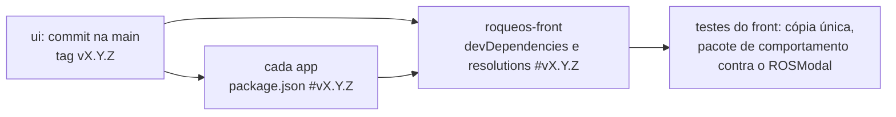

# Operação

_Português | [English](../OPERATIONS.md)_

> **Para quem:** o mantenedor, e quem lança uma versão ou sobe os apps para ela.
> **O que tem aqui:** a rotina de manutenção, lançar uma tag, atualizar sem quebrar os apps,
> desfazer, backup, e o que monitorar.
> **Onde ir para o resto:** uma falha com a mensagem está em
> [QUANDO-QUEBRA.md](QUANDO-QUEBRA.md); quem consome o pacote e como está em
> [INTEGRACOES.md](INTEGRACOES.md).

## Sumário

1. [A rotina](#1-a-rotina)
2. [Lançar uma versão](#2-lançar-uma-versão)
3. [Atualizar sem quebrar](#3-atualizar-sem-quebrar)
4. [Desfazer](#4-desfazer)
5. [Backup e restauração](#5-backup-e-restauração)
6. [O que monitorar](#6-o-que-monitorar)

## 1. A rotina

Não há agenda e nada roda sozinho além do CI. A rotina de manutenção do kit é o
[.claude/loop.md](../../.claude/loop.md): uma coisa por iteração, para na primeira que tiver
trabalho.

| Ordem | Confere                          | Como                                                                                             |
| ----- | -------------------------------- | ------------------------------------------------------------------------------------------------ |
| 1     | Gate vermelho                    | `roqueos-gate` (que roda o `yarn verificar`); conserta e cola a saída                            |
| 2     | CI do GitHub vermelho            | `gh run list --limit 3`; vermelho lá e verde aqui é ambiente divergente, e se investiga primeiro |
| 3     | PR sem `Signed-off-by`           | o check `dco` reprova; quem contribui recebe `git rebase --signoff main`                         |
| 4     | Issue ou PR de fora sem resposta | `gh issue list`, `gh pr list`                                                                    |
| 5     | Comportamento divergente         | linha nova no `PULAR` do front do RoqueOS, ou comportamento que o kit perdeu, vira issue aqui    |
| 6     | SDK atrás                        | variável de tema nova entra no `app-sdk` primeiro, com tag, depois aqui                          |
| 7     | Drift de docs                    | README, CHANGELOG e a lista de componentes dizem a mesma coisa; o `roqueos-docs` diz `ok`        |

Mudança visível não fecha sem a vitrine aberta de verdade (`yarn dev`), com print, e sem o app
que usa o componente aberto no RoqueOS quando a mudança chega lá.

## 2. Lançar uma versão

Não há script nem workflow de lançamento no repo (o [.github/workflows/](../../.github/workflows/ci.yml)
só tem o `verificar` e o `dco`). Uma versão é uma tag git `vX.Y.Z` na `main` que bate com o
`version` do [package.json](../../package.json) e com uma seção do
[CHANGELOG.md](../../CHANGELOG.md). O CHANGELOG diz a regra: componente ou prop nova é versão
menor; mudar o que um componente faz com a mesma prop, ou tirar uma, é versão maior.

```bash
yarn verificar
# package.json: "version": "0.7.0"; CHANGELOG.md: [Não lançado] vira [0.7.0] - data
git commit -s -am "versao 0.7.0"
git tag v0.7.0
git push origin main v0.7.0
```

Os números de versão acima são exemplo. O kit não é publicado em outro lugar: o
`"private": true` o mantém fora do npm.



## 3. Atualizar sem quebrar

O front do RoqueOS força uma cópia só do kit para todos os apps pelo `resolutions`, e o teste
`apps-de-primeira-parte` dele reprova se o `resolutions` e o `devDependencies` divergem ou se
um app instalado traz cópia própria. Um app que pede uma tag mais velha recebe a do front.
Então:

1. Dentro da 0.x, mude só de forma compatível (prop nova, componente novo, ícone novo), ou
   planeje subir todos os apps juntos.
2. Quando o kit precisa de uma variável de tema nova, a ordem é `app-sdk` (variável e tag),
   depois o kit (devDependency na tag nova do SDK, `yarn verificar`, tag nova do kit), depois
   os apps e o front. Essa ordem está no grafo do `roqueos-kit` (`roqueos-graph blast`).
3. Mudar foco, Esc ou Tab muda o que as pessoas sentem nas duas famílias. Um comportamento novo
   no pacote pode reprovar o `ROSModal` no front na mesma subida; é a ideia, e o front registra
   isso no `PULAR` dele com o motivo.
4. Suba os apps trocando a tag no `package.json` deles e rodando o gate de cada um; depois o
   `devDependencies` e o `resolutions` do front, na mesma tag.

## 4. Desfazer

| Passo irreversível              | Como desfazer                                                                                                                           |
| ------------------------------- | --------------------------------------------------------------------------------------------------------------------------------------- |
| Um commit mergeado na `main`    | `git revert -s <commit>` num PR novo; nunca force push na `main`                                                                        |
| Uma tag empurrada               | não mova nem apague: o lockfile de quem consome trava o commit ([SECURITY.md](../../SECURITY.md)); lance o próximo patch com a correção |
| Um app subido para uma tag ruim | volte a tag anterior no `package.json` do app (e no `resolutions` do front), `yarn install`                                             |
| Um `src/icones.js` regerado     | `git checkout -- src/icones.js`, ou rode o `scripts/icones.mjs` de novo com o `@quasar/extras` certo                                    |

## 5. Backup e restauração

O kit não tem dado nem estado. O repo no GitHub é o backup; as tags são as versões. Restaurar é
`git clone https://github.com/roqueos-apps/ui.git` e o [COMECAR.md](COMECAR.md). Os caminhos
dos ícones se refazem a partir de qualquer checkout do `@quasar/extras` 1.18.0 (o do
`roqueos-front` serve, diz o [scripts/icones.mjs](../../scripts/icones.mjs)).

## 6. O que monitorar

| Sinal                                | Saudável                                                                                           |
| ------------------------------------ | -------------------------------------------------------------------------------------------------- |
| `yarn verificar`                     | termina em `ok, o repo cumpre o contrato.`; 5 arquivos e 38 testes passando (medido em 18/11/2026) |
| GitHub Actions `verificar` na `main` | verde nas últimas execuções (`gh run list --limit 3`)                                              |
| `dco` em cada PR                     | verde                                                                                              |
| A lista `PULAR` do front             | não cresce                                                                                         |
| `roqueos-docs`                       | `roqueos-docs: ok`                                                                                 |
| `roqueos-doctor`                     | nenhuma linha `nao` além das já explicadas no PR que as trouxe                                     |
